<!--
  The animated cards in assets/ are generated by scripts/build_assets.py.
  To change any wording, edit it there and run: python3 scripts/build_assets.py
-->

  
  
  
  

### <samp>01</samp>&nbsp; whoami

### <samp>02</samp>&nbsp; Toolkit

  <picture>
    <source media="(prefers-color-scheme: light)" srcset="https://skillicons.dev/icons?i=react%2Cnextjs%2Cts%2Cvite%2Ctailwind%2Ccs%2Cdotnet%2Cpy%2Cfastapi%2Cnodejs%2Cpostgres%2Csupabase%2Csqlite%2Cswift%2Capple%2Cdocker%2Cnginx%2Cvercel%2Cnetlify%2Ccloudflare&perline=10&theme=light" />
    
  </picture>

<picture>
  <source media="(prefers-color-scheme: dark)" srcset="https://raw.githubusercontent.com/gking09/gking09/output/snake-dark.svg" />
  <source media="(prefers-color-scheme: light)" srcset="https://raw.githubusercontent.com/gking09/gking09/output/snake-light.svg" />
  
</picture>

